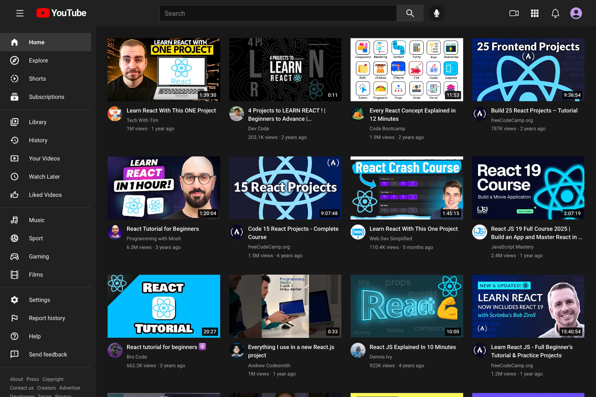
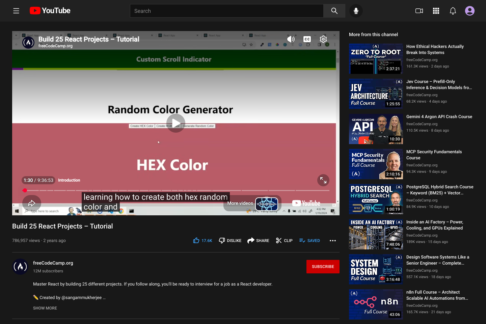
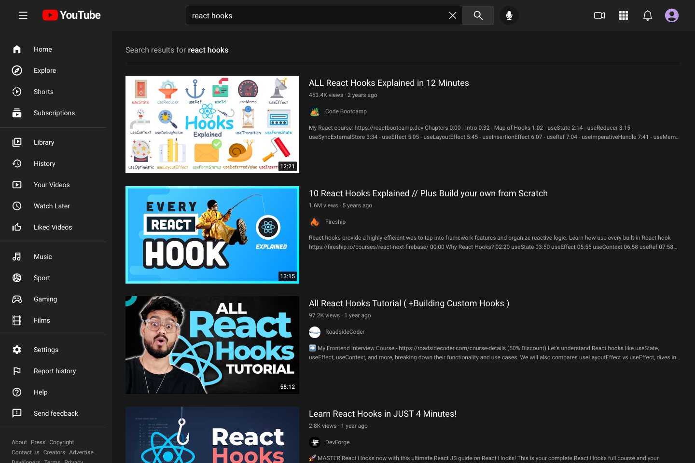
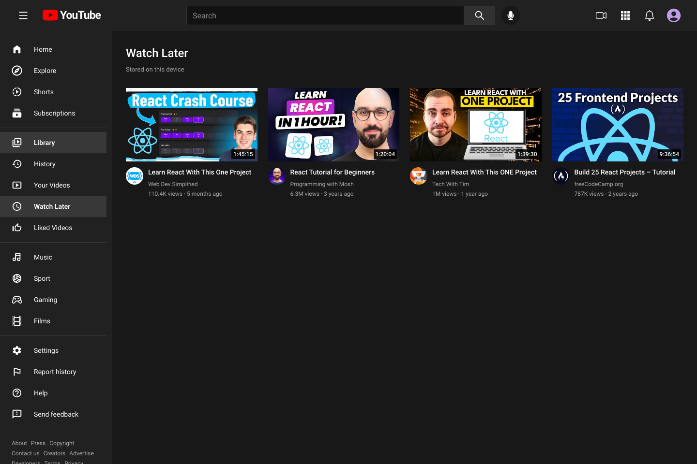
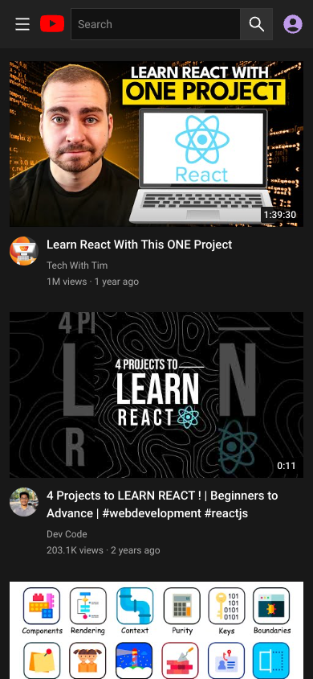
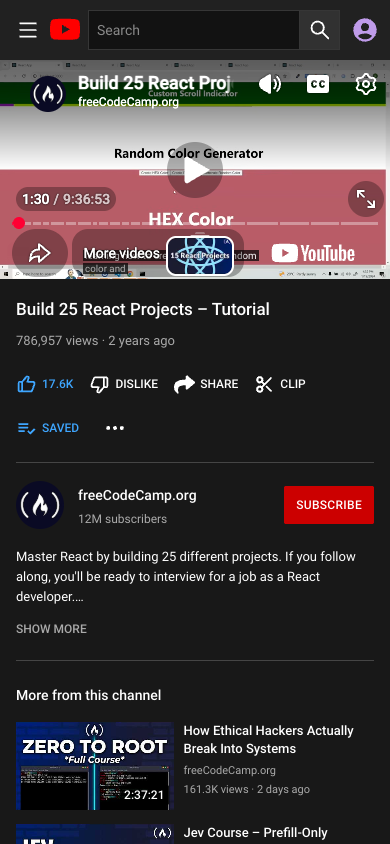

# YouTube Clone

A responsive video browsing application built with **React, TypeScript, Redux Toolkit, and the YouTube Data API**.

This portfolio project demonstrates how familiar product flows can be implemented with reusable components, custom hooks, typed API services, predictable state management, and automated tests. It rebuilds and refactors a reference YouTube clone into a modular application with current tooling.

Browse videos, search for a topic, open a watch page, and keep a personal library on your device.

[Features](#features) · [Screenshots](#screenshots) · [Architecture](#architecture) · [Run locally](#run-locally) · [Guidelines](#guidelines)



## Features

| Experience              | What you can do                                                                                                                                                           |
| ----------------------- | ------------------------------------------------------------------------------------------------------------------------------------------------------------------------- |
| Home feed               | Browse video cards with channel details, durations, view counts, and publication dates. Load more results as you scroll.                                                  |
| Search                  | Submit a topic from the navigation bar and browse a dedicated results layout. Search queries live in the URL, supporting refreshes, direct links, and browser navigation. |
| Watch page              | Play videos through YouTube's embedded player, read an expandable description, view channel statistics, and discover more uploads from the same channel.                  |
| Personal library        | Save videos for later, like or dislike videos, subscribe to channels locally, and revisit watch history.                                                                  |
| Responsive navigation   | Use a collapsible sidebar on desktop and a navigation drawer on mobile.                                                                                                   |
| Feedback and recovery   | See explicit loading, empty, unavailable-video, API-key, quota, and connection states, with retry controls where appropriate.                                             |
| Accessible interactions | Navigate with semantic links and buttons, visible focus indicators, labelled controls, a skip link, and an Escape shortcut for the mobile drawer.                         |

Likes, saves, subscriptions, and history are stored in the browser on the current device. They do not modify a YouTube account.

## Screenshots

Captured from the running application with live public YouTube data. Video availability, results, and statistics may change.

### Watch page

Embedded playback, video actions, channel information, an expandable description, and channel recommendations.



<details>
<summary><strong>Search results</strong></summary>

A separate results layout with video descriptions, channel avatars, and URL-based search.



</details>

<details>
<summary><strong>Saved-video library</strong></summary>

Videos saved from the watch page remain available through the local Watch Later collection.



</details>

### Mobile views

| Home feed                                                                                                                  | Watch page                                                                                                                            |
| -------------------------------------------------------------------------------------------------------------------------- | ------------------------------------------------------------------------------------------------------------------------------------- |
|  |  |

## Tech stack

| Layer       | Tools                                                        |
| ----------- | ------------------------------------------------------------ |
| UI          | React 19, TypeScript 7, React Icons                          |
| Routing     | React Router 8 with lazy-loaded pages                        |
| State       | Redux Toolkit, typed actions and selectors, React Redux      |
| Data        | Axios and YouTube Data API v3                                |
| Styling     | Tailwind CSS 4 and responsive CSS                            |
| Build       | Vite 8                                                       |
| Testing     | Vitest, React Testing Library, user-event, jsdom             |
| Persistence | Browser localStorage with validation and bounded collections |

## Architecture

The project separates route composition, presentation, data access, and state transitions. Pages compose feature components; custom hooks coordinate behaviour; the API layer maps external responses into application models.

```text
src/
  components/
    common/          Shared controls, avatars, loading and error feedback
    layout/          Application shell, navigation, sidebar, and search bar
  features/
    videos/          API mapping, models, Redux actions, reducer, and selectors
      components/    Cards, thumbnails, player, details, and recommendations
      hooks/         Feed loading, watch lifecycle, and video interactions
    library/         Local library actions, reducer, validation, and persistence
  hooks/             Shared search, navigation, media-query, and scrolling hooks
  pages/             Route-level composition
  routes/            Lazy route definitions and URL helpers
  services/          HTTP client, timeouts, and API error handling
  store/             Store factory, persistence middleware, and typed hooks
  test/              Shared fixtures and test setup
  utils/             Environment configuration and display formatting
public/              Static application assets
docs/screenshots/    Screenshots used in this README
```

### Engineering decisions

- **Reusable presentation:** A shared video card supports grid, search, and compact recommendation layouts without duplicating the underlying model.
- **Custom hooks:** Feed loading, infinite scrolling, search drafts, watch-page requests, and video actions are separated from presentation components.
- **Request lifecycle control:** Abort signals cancel obsolete requests. Request IDs prevent late responses from replacing newer search or video data.
- **Reliable pagination:** Independent home and search state tracks real page tokens, prevents concurrent page requests, and deduplicates videos. A manual load-more button supplements automatic loading.
- **Typed API mapping:** Video and channel metadata is joined by ID rather than response position, with fallbacks for missing statistics or unavailable content.
- **Focused state ownership:** URLs hold submitted search queries, Redux holds shared application data, and component state handles temporary UI interactions.
- **Resilient local persistence:** Library entries are validated when restored. Storage failures are handled without preventing the app from running.

## Run locally

### 1. Install dependencies

From the project root, use **Node.js 26** as pinned in `.nvmrc` and **npm 10 or newer**. If you use nvm:

```sh
nvm install
nvm use
npm ci
```

Without nvm, install the Node version specified in `.nvmrc`, then run `npm ci`.

### 2. Configure the YouTube API

Create a Google Cloud project, enable **YouTube Data API v3**, and create an API key. See the [official YouTube API setup guide](https://developers.google.com/youtube/data/getting-started).

Create a local environment file:

```sh
cp .env.example .env.local
```

Set your own key in `.env.local`:

```dotenv
VITE_YOUTUBE_DATA_API_KEY=your_youtube_data_api_key
```

The legacy `REACT_APP_YOUTUBE_DATA_API_KEY` variable remains supported for existing checkouts. `VITE_YOUTUBE_DATA_API_KEY` takes precedence when both are present. Restart the development server after changing environment files.

**Client-side API-key visibility:** This application currently calls YouTube from the browser. Environment variables used by the frontend are included in the browser bundle; `.env.local` does not make the key secret. Restrict a development key to the YouTube Data API and permitted website origins. For a public production deployment, move credentialed requests behind a backend or serverless endpoint with appropriate request limits. See [Vite's environment-variable documentation](https://vite.dev/guide/env-and-mode#env-variables) and [Google's API-key guidelines](https://docs.cloud.google.com/docs/authentication/api-keys-best-practices).

### 3. Start the app

```sh
npm start
```

Open [http://localhost:3000](http://localhost:3000). `npm run dev` starts the same development server.

### 4. Run the checks

```sh
npm run typecheck
npm test
npm run build
```

The tests use deterministic fixtures and do not require a live API key. They cover the main navigation flows, search, pagination, watch interactions, error recovery, Strict Mode, stale responses, cancellation, API mapping, display formatting, and local library persistence.

### Available commands

| Command                     | Purpose                                                   |
| --------------------------- | --------------------------------------------------------- |
| `npm start` / `npm run dev` | Start the development server with hot reload              |
| `npm run typecheck`         | Check application, test, and configuration types          |
| `npm test`                  | Run the test suite once                                   |
| `npm run test:watch`        | Rerun tests while developing                              |
| `npm run build`             | Type-check and generate the production bundle in `build/` |
| `npm run preview`           | Serve the production build locally for inspection         |

For static hosting, publish `build/` and configure a fallback to `index.html` for client-side routes such as `/search` and `/watch/:id`.

## Guidelines

### Development and contributions

- Keep route pages focused on composition. Put reusable UI in components and reusable behaviour in custom hooks.
- Keep HTTP calls and response mapping in the service and feature API layers. Use typed models, Redux actions, and selectors for shared data.
- Handle loading, empty, error, and cancellation states when adding asynchronous flows.
- Preserve keyboard access, semantic controls, descriptive labels, and responsive behaviour when changing the interface.
- Test observable behaviour, including navigation and failure recovery. Run type checks, tests, and the production build before submitting changes.
- Update the README and screenshots when a change affects setup, architecture, or a visible flow.

### Credentials and publishing

- Use your own restricted API key. Never include credentials in screenshots, documentation, issue reports, or commits.
- Keep environment examples as placeholders. Share `.env.example` rather than populated environment files.
- Before publishing a repository, check tracked files and Git history for existing credentials. Ignoring an environment file does not remove earlier commits; remove exposed values from history and rotate affected keys.
- Keep the frontend key visibility described above in mind when deploying. The current implementation is a frontend portfolio application, not a completed production backend.

## Scope and attribution

This is an educational portfolio project inspired by YouTube's browsing experience and rebuilt from a reference clone. It focuses on frontend architecture, API integration, interaction design, and testing.

Playback is provided by YouTube's embedded player. Recommendations are recent uploads from the selected video's channel rather than a personalised recommendation algorithm. Uploading, account settings, and other account-specific actions open YouTube. Local library data does not synchronise between devices or with a YouTube account.

Playback availability also depends on each video's embedding permissions and regional restrictions; some videos must be watched directly on YouTube.

The project is not affiliated with or endorsed by YouTube or Google. Brand names and video content belong to their respective owners.
